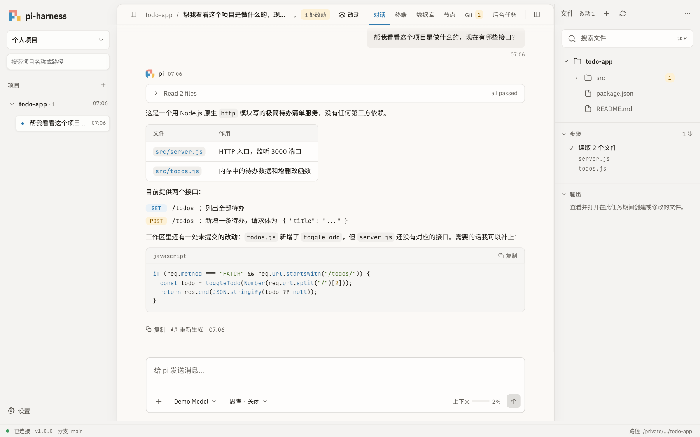
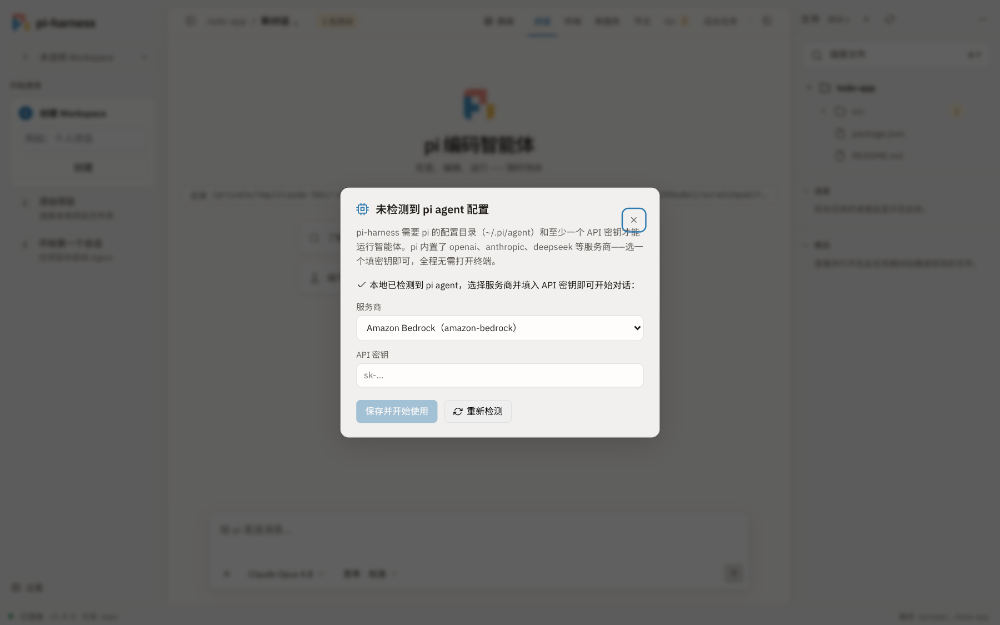
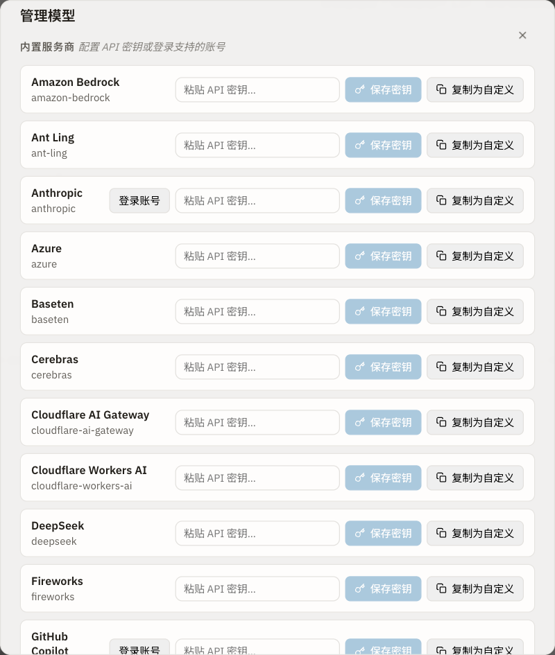
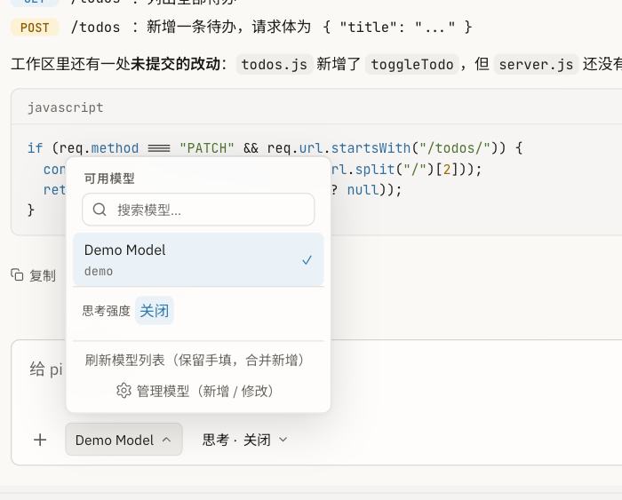
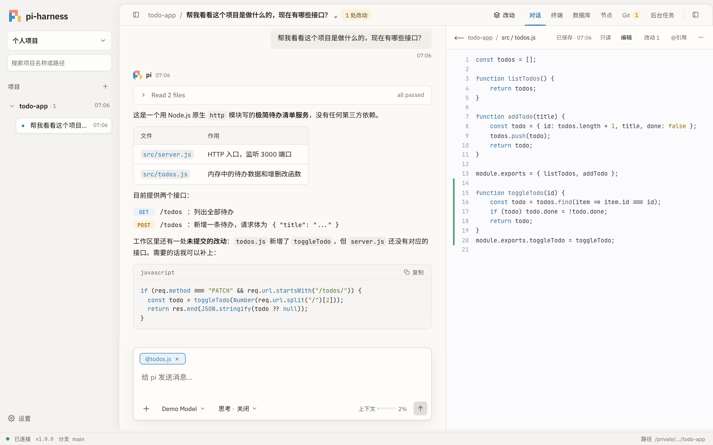
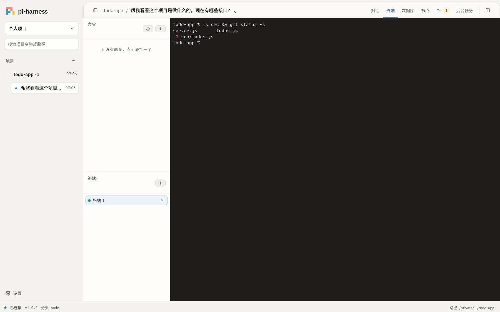
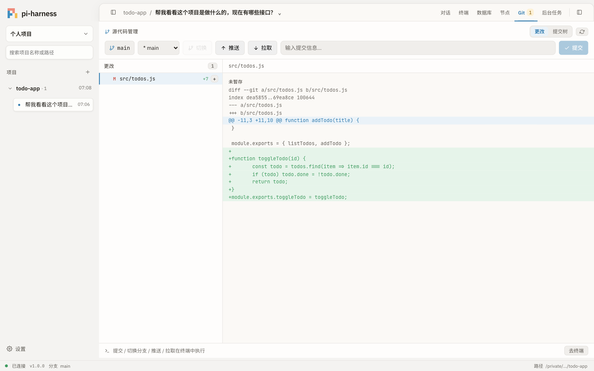
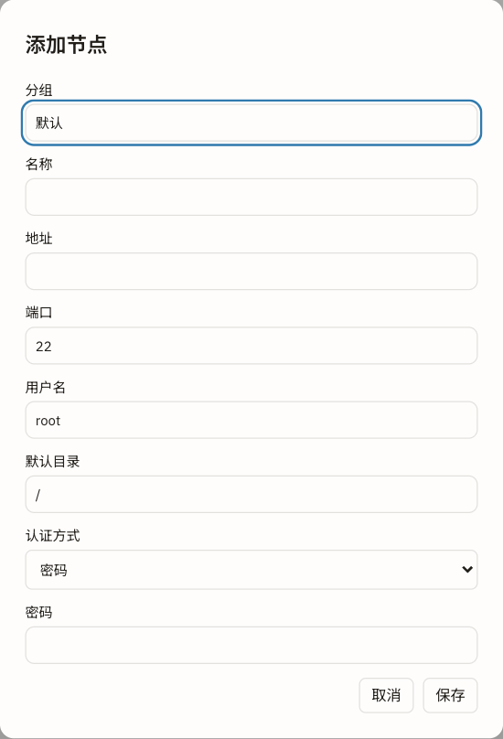

# pi-harness

[](https://github.com/youweichen0208/pi-harness/releases)
[](https://github.com/youweichen0208/pi-harness/actions/workflows/ci.yml)


[中文](#这是什么) · [English](#english)

在**浏览器或桌面窗口**里使用 AI 编程助手 [pi](https://www.npmjs.com/package/@earendil-works/pi-coding-agent)：
用聊天的方式让 AI 阅读、修改、运行你的项目，同时看得到文件、终端和 Git 改动，不用记任何命令。

> 例如你可以直接说：“帮我看看这个项目是做什么的”、“这个接口为什么报 500？”、
> “给 todos.js 写单元测试并跑一遍”、“帮我登录 web-01 看看磁盘还剩多少”。



---

## 目录

- [这是什么](#这是什么)
- [能做什么](#能做什么)
- [开始之前：准备清单](#开始之前准备清单)
- [安装方式一：桌面版（最简单）](#安装方式一桌面版最简单)
- [安装方式二：命令行 npm](#安装方式二命令行-npm)
- [第一次使用](#第一次使用)
- [功能导览](#功能导览)
- [安全须知](#安全须知)
- [开机自启、Docker 与升级](#开机自启docker-与升级)
- [常见问题](#常见问题)
- [更多文档](#更多文档)

---

## 这是什么

**pi** 是一个开源的 AI 编程智能体（coding agent）：它能读文件、改代码、执行命令，
帮你完成开发任务。pi 原本只在终端里使用，**pi-harness** 给它加上了图形界面：

| 你看到的 | 说明 |
| --- | --- |
| 左栏 | 项目和历史对话，可以按 Workspace 分组 |
| 中间 | 和 AI 对话；AI 做了什么（读了哪些文件、跑了什么命令）都会显示出来 |
| 右栏 | 项目文件树、文件预览与编辑、当前任务进度 |
| 顶栏 | 在 **对话 / 终端 / 数据库 / 节点 / Git** 等视图之间切换；工作区有未提交改动时，标题旁会显示「N 处改动」 |

它**运行在你自己的电脑上**，默认只允许本机访问。你的代码不会上传到 pi-harness 的服务器
（它没有服务器）；对话内容只会发给你自己选择的 AI 模型服务商。

---

## 能做什么

| 场景 | 你可以这样做 |
| --- | --- |
| 了解陌生项目 | 打开项目，问“这个项目是做什么的？入口在哪？” |
| 写代码、改 Bug | 描述需求，AI 修改文件，右侧和聊天里都能看到逐行改动 |
| 运行和测试 | 让 AI 执行 `npm test` 等命令，或者自己在内置终端里操作 |
| 指定上下文 | 把文件、文件中的几行、截图拖进输入框，作为提问附件 |
| 查看和编辑文件 | 右侧文件树点开即可预览，代码文件可直接编辑保存 |
| 查看 Git 改动 | Git 视图列出改动文件和差异，提交 / 推送在终端里执行 |
| 管理远程服务器 | “节点”视图保存 SSH 服务器，打开多个远程终端，并让 AI 帮你在服务器上排查问题 |
| 查询数据库 | “数据库”视图连接 MySQL / PostgreSQL，执行只读查询，并可授权 AI 只读访问 |
| 多项目并行 | 每个项目可以同时开多个对话，切换项目不会打断正在运行的任务 |
| 写文档 | 点开 `.md` 文件进入 Wiki 文档编辑，标题下可插入自动更新的目录，右侧可以直接让 AI 帮你改 |
| 切换模型 | 输入框下方随时切换模型和思考强度，支持 OpenAI、Anthropic、DeepSeek 等几十家服务商 |

界面支持中文 / English（左下角 **设置** → 语言），任务完成时可以响铃提醒。**设置 → 外观** 提供 5 种背景色调（暖白、雾蓝、鼠尾草、燕麦、石墨），也可以跟随系统深浅色。

---

## 开始之前：准备清单

| # | 需要准备 | 说明 |
| --- | --- | --- |
| 1 | 一台电脑 | macOS（Apple 芯片）、Windows 10/11 或 Linux |
| 2 | **一个 AI 模型的 API 密钥** | 例如 DeepSeek、OpenAI、Anthropic、Kimi、通义千问等，在服务商官网注册后获取；部分服务商（如 ChatGPT、Claude、GitHub Copilot）也可以直接登录账号 |
| 3 | 一个想让 AI 帮忙的项目文件夹 | 建议是用 **Git** 管理的项目，这样 AI 改坏了也能随时还原 |
| 4 | （仅命令行安装需要）**Node.js 22.19.0 或更高版本** | 桌面版不需要，安装方法见下文 |

> 💡 不知道选哪家模型？国内用户可以先试 DeepSeek 或 Kimi，注册后在控制台创建一个 API Key 即可。
> API 按用量计费，请留意服务商的价格说明。

---

## 安装方式一：桌面版（最简单）

不需要安装 Node.js，下载后双击即可。

1. 打开 [GitHub Releases](https://github.com/youweichen0208/pi-harness/releases)，在最新版本的 **Assets** 中下载对应文件：

   | 系统 | 下载哪个文件 |
   | --- | --- |
   | macOS（Apple 芯片：M1/M2/M3/M4） | `pi-<版本>-mac-arm64.dmg` |
   | Windows | `pi-<版本>-setup-x64.exe`（安装版），或 `pi-<版本>-win-x64.exe`（免安装便携版） |
   | Linux | `.AppImage` 文件，或 Debian / Ubuntu 用 `.deb` 文件 |

2. 安装并打开：

   - **macOS**：打开 dmg，把 **pi** 拖进“应用程序”。因为没有 Apple 付费签名，第一次打开会被拦截：
     - macOS 15 及以后：先双击一次，然后到 **系统设置 → 隐私与安全性**，在页面下方点 **仍要打开**。
     - macOS 14 及更早：在“应用程序”里**右键 pi → 打开**，再点“打开”。
   - **Windows**：双击安装包。如果出现蓝色的“Windows 已保护你的电脑”，点 **更多信息 → 仍要运行**。
   - **Linux**：AppImage 需要先 `chmod +x pi-*.AppImage` 再双击；deb 包用 `sudo apt install ./下载的文件名.deb` 安装，命令名为 `pi-harness`。

3. 打开后直接进入 [第一次使用](#第一次使用)。

---

## 安装方式二：命令行 npm

适合习惯终端、想用浏览器访问，或者需要在服务器上部署的用户。

### 步骤 1：安装 Node.js

前往 <https://nodejs.org/> 下载并安装 **LTS 版本**（需 22.19.0 或更高）。安装完成后，打开终端
（macOS 的“终端”，Windows 的 “PowerShell”）执行：

```bash
node -v
```

看到 `v22.19.0` 或更高的版本号即可。

### 步骤 2：安装 pi-harness

```bash
npm install -g @youweichen/pi-harness
```

> 国内网络较慢时，可以先执行 `npm config set registry https://registry.npmmirror.com` 切换到国内镜像。

> ℹ️ 目前正式发布以**桌面版**为主，npm 上的版本可能落后于 [GitHub Releases](https://github.com/youweichen0208/pi-harness/releases) 的最新版；想用最新功能请优先使用桌面版。

### 步骤 3：在项目目录里启动

先用 `cd` 进入你的项目文件夹，然后运行：

```bash
pi-harness
```

浏览器会自动打开 <http://127.0.0.1:8787>。**终端窗口不要关**，关掉服务就停止了；用完按 `Ctrl + C` 退出。

也可以在任何位置启动并指定端口和项目目录：

```bash
pi-harness --port 9000 --cwd /path/to/project
```

不想全局安装，也可以用 `npx @youweichen/pi-harness` 临时运行。

---

## 第一次使用

### 1. 填写 API 密钥

第一次打开时，如果还没有配置过模型，会弹出下面的窗口。在“服务商”中选择你注册的服务商，
粘贴 API 密钥，点 **保存并开始使用**。全程不需要打开终端。



> 🔐 密钥只保存在你自己电脑的 `~/.pi/agent/auth.json` 中，不会显示在聊天里，也不会发给浏览器。

以后想添加别的服务商、换密钥，或者用 ChatGPT / Claude / GitHub Copilot 账号登录：
点输入框下方的模型名称 → **管理模型（新增 / 修改）**。



### 2. 创建 Workspace 并添加项目

1. 左栏顶部输入一个 Workspace 名称（例如“个人项目”），点 **创建**。Workspace 只是项目的分组。
2. 点“项目”右边的 **+**，在弹出的窗口里找到你的项目文件夹（也可以直接粘贴路径），点 **添加项目到分组**。
3. 用 `pi-harness` 命令启动时，当前目录已经打开，直接点 **加入当前项目** 即可。

### 3. 开始对话

在底部输入框里描述你想做的事，按 `Enter` 发送（`Shift + Enter` 换行）。AI 读取了哪些文件、
执行了哪些命令，都会以卡片形式显示在回复上方，点击可以展开查看详情。

- **输入框左下角 `+`**：附加文件、图片，或者直接把文件拖进窗口。
- **模型 / 思考强度**：输入框下方切换。思考强度越高，回答越仔细，但也更慢、更费 token。
- **AI 正在工作时**：可以继续输入补充要求；点停止按钮可以随时中断。



---

## 功能导览

### 文件预览与编辑

点右侧文件树里的文件即可打开预览。代码文件支持高亮和直接编辑；点 **@引用** 可以把文件加入下一条消息。
Git 有改动的文件会带 `M` 等标记，左侧绿线表示新增的行。



### 内置终端

顶栏切到 **终端**，就是一个真正的命令行，默认位于当前项目目录。可以开多个终端标签，
常用命令可以保存在左侧“命令”列表里一键执行。



### Git

顶栏切到 **Git**，查看改动的文件和每个文件的差异，填写提交信息后提交。
提交、推送、拉取会在可见的终端中执行，输出一目了然。



### SSH 节点（远程服务器）

顶栏切到 **节点**，点 **+** 添加服务器：填写分组、名称、地址、端口、用户名，选择密码、私钥或 SSH Agent 认证。
也可以从 `~/.ssh/config` 或 Xshell 会话一键导入。



连接后可以开多个远程终端标签，通过 SFTP 浏览文件，右侧还有专属于这台服务器的 AI 对话。
AI 执行的每条命令都显示在当前终端里，你随时能看到它在做什么。

- 首次连接会显示服务器的主机密钥指纹，确认无误再点“信任”。
- 密码和私钥口令加密保存在本机，导出节点列表时不包含凭据。
- AI 在服务器上能做什么，取决于你登录用的账号权限。生产服务器建议使用权限受限的账号。

详细说明见 [SSH 节点工作台手册](docs/ssh-workbench.md)；Windows 上使用 Xshell 的用户可参考 [Xshell 与 SSH 连接手册](docs/xshell.md)。

### 更多

- **数据库**：连接 MySQL / PostgreSQL，执行只读查询；你可以为某个对话单独授权 AI 只读访问。
- **后台任务**：AI 启动的开发服务器（例如 `npm run dev`）会列在这里，可以一键停止。
- **设置**：外观（5 种背景色调、跟随系统深浅色）、系统提示词、技能（Skills）、扩展、MCP 服务，以及检查更新。
- **Wiki 文档**：点击文件树里的 `.md` 文件打开可编辑文档；自动维护的目录会随标题更新，弹窗右侧的 Agent Chat 复用当前对话，可以选中文字后「问 pi」。
- **快捷键**：`Ctrl/⌘ + K` 全局搜索历史对话和文件，`Ctrl/⌘ + P` 代码搜索，`Ctrl/⌘ + F` 在当前对话中搜索。

---

## 安全须知

AI 编程助手能够在你的电脑上**修改文件和执行命令**，请花一分钟了解：

- ✅ **默认只允许本机访问**：服务只监听 `127.0.0.1`，同一局域网的其他设备打不开。
- ✅ **过程透明**：AI 的每次文件读写和命令执行都会在界面上显示，可以随时点停止中断。
- ⚠️ **建议在 Git 项目中使用**：开始前先提交一次，AI 改得不满意时可以用 Git 还原。
- ⚠️ **不要把服务直接暴露到公网**。确实需要从手机或其他电脑访问时，先设置访问口令
  `PI_WEB_TOKEN`，并按 [部署文档](docs/deployment.md) 配置 `PI_WEB_HOST` 和 `PI_WEB_ALLOW_HOSTS`。
- 🔐 API 密钥、SSH 密码只保存在本机，不会发给浏览器页面，也不会出现在对话中。

---

## 开机自启、Docker 与升级

<details>
<summary><b>开机自动启动（命令行版）</b></summary>

```bash
pi-harness server install --port 8787 --cwd /path/to/project
```

macOS 使用 launchd，Linux 使用 systemd，Windows 使用计划任务。之后可以用下面的命令管理：

```bash
pi-harness server status
pi-harness server restart
pi-harness server stop
pi-harness server uninstall
```

`pi-harness server shortcut` 还可以在桌面创建一个“一键启动”图标。

</details>

<details>
<summary><b>Docker</b></summary>

```bash
docker compose up -d
```

默认只映射到本机 `127.0.0.1:8787`。数据卷、挂载项目目录、对外开放的注意事项见 [部署文档](docs/deployment.md#docker)。

</details>

<details>
<summary><b>升级</b></summary>

- **桌面版**：到 [Releases](https://github.com/youweichen0208/pi-harness/releases) 下载新版本覆盖安装，对话和设置会保留。
- **命令行版**：

  ```bash
  npm install -g @youweichen/pi-harness@latest
  ```

  如果装了开机自启服务，升级后执行 `pi-harness server restart` 才会加载新版本。

- **从旧包 `@youweichen/pi-web-ui` 迁移**：1.0.0 起包名改为 `@youweichen/pi-harness`，旧包不再更新。
  旧的开机自启服务会占用同一端口，请先运行 `pi-web-ui server uninstall` 和
  `npm uninstall -g @youweichen/pi-web-ui`，再安装新包；需要开机自启时重新运行
  `pi-harness server install`（带上原来的 `--port` / `--cwd`）。

</details>

---

## 常见问题

<details>
<summary><b>发消息后没有反应，或者提示没有可用模型</b></summary>

- 点输入框下方的模型名称，确认已经选中一个模型。
- 打开 **管理模型**，检查对应服务商的 API 密钥是否填写正确、账户是否还有余额。
- 底部状态栏应显示“已连接”。如果显示断开，检查启动 pi-harness 的终端窗口是否被关闭。

</details>

<details>
<summary><b>启动时提示端口被占用</b></summary>

说明 8787 端口已经被别的程序（或另一个 pi-harness）使用。换一个端口启动：

```bash
pi-harness --port 9000
```

如果之前装过开机自启服务，它可能已经在运行，直接打开 <http://127.0.0.1:8787> 即可，
或用 `pi-harness server status` 查看。

</details>

<details>
<summary><b>安装时报错，或提示 Node.js 版本过低</b></summary>

- 执行 `node -v`，版本必须 ≥ 22.19.0；过低请到 <https://nodejs.org/> 安装新版 LTS。
- macOS / Linux 上 `npm install -g` 报权限错误（`EACCES`）时，不要用 `sudo`，
  建议用 [nvm](https://github.com/nvm-sh/nvm) 安装 Node.js 后重新安装。
- 不想处理 Node.js 环境，可以直接使用 [桌面版](#安装方式一桌面版最简单)。

</details>

<details>
<summary><b>macOS 提示“无法打开 pi，因为无法验证开发者”</b></summary>

桌面版没有 Apple 付费签名，属于正常现象：

- macOS 15 及以后：**系统设置 → 隐私与安全性**，在下方找到 pi，点 **仍要打开**。
- macOS 14 及更早：在“应用程序”里右键 pi → **打开**。

</details>

<details>
<summary><b>Windows 提示“Windows 已保护你的电脑”</b></summary>

安装包没有付费代码签名，SmartScreen 会拦截。点 **更多信息 → 仍要运行** 即可。

</details>

<details>
<summary><b>想在手机或另一台电脑上访问</b></summary>

默认只允许本机访问。需要局域网访问时：

```bash
PI_WEB_TOKEN=换成你自己的长口令 PI_WEB_HOST=0.0.0.0 PI_WEB_ALLOW_HOSTS=你的电脑IP pi-harness
```

然后在另一台设备打开 `http://你的电脑IP:8787/?token=你的口令`。AI 可以在你的电脑上执行命令，
**口令务必足够复杂，且不要暴露到公网**。完整说明见 [环境变量参考](docs/env-vars.md)。

</details>

<details>
<summary><b>对话和设置保存在哪里？</b></summary>

| 内容 | 位置 |
| --- | --- |
| 模型配置、API 密钥、对话记录 | `~/.pi/agent`（与 pi 命令行共用） |
| 界面状态、上传的附件、插件 | `~/.pi-web` |

已经在终端使用 pi 的用户，原有配置和对话会直接出现在 pi-harness 里。

</details>

<details>
<summary><b>AI 把代码改坏了怎么办？</b></summary>

- 在 Git 视图查看具体改了什么，用 `git checkout -- <文件>` 或 `git stash` 还原。
- 对话中可以点自己发过的消息重新编辑并发送，从那一步重新开始。
- 建议养成习惯：让 AI 动手前先提交一次。

</details>

---

## 更多文档

| 文档 | 内容 |
| --- | --- |
| [SSH 节点工作台手册](docs/ssh-workbench.md) | 添加服务器、密钥配置、SFTP、故障排查 |
| [Xshell 与 SSH 连接手册](docs/xshell.md) | 从 Xshell 导入会话 |
| [部署文档](docs/deployment.md) | 命令行参数、开机自启、Docker、桌面版细节 |
| [环境变量参考](docs/env-vars.md) | 端口、监听地址、访问口令等全部配置项 |
| [开发指南](docs/development.md) | 从源码构建、测试（贡献者） |
| [发布记录](https://github.com/youweichen0208/pi-harness/releases) | 版本变更 |

问题反馈与建议：[GitHub Issues](https://github.com/youweichen0208/pi-harness/issues)

---

## English

pi-harness is a web and desktop interface for the [pi coding agent](https://www.npmjs.com/package/@earendil-works/pi-coding-agent). Chat with an AI agent that reads, edits and runs your project, while you see the file tree, file previews, a built-in terminal, Git changes, database queries and a built-in SSH workbench for remote servers. Everything runs on your own machine and listens on `127.0.0.1` by default.

**Quick start**

- **Desktop app (easiest):** download the installer for your OS from [GitHub Releases](https://github.com/youweichen0208/pi-harness/releases) (`.dmg` for Apple Silicon Macs, `setup-x64.exe` for Windows, `.AppImage` / `.deb` for Linux). The builds are not code-signed: on macOS 15+ allow the app under *System Settings → Privacy & Security*; on Windows choose *More info → Run anyway*.
- **npm:** requires Node.js **>= 22.19.0**. The npm package may lag behind the latest GitHub Release; the desktop app is the primary distribution.

  ```bash
  npm install -g @youweichen/pi-harness
  pi-harness                      # opens http://127.0.0.1:8787
  pi-harness --port 9000 --cwd /path/to/project
  ```

On first launch, pick a model provider (OpenAI, Anthropic, DeepSeek and many more) and paste an API key, or sign in with a supported account under *Manage models*. Keys stay in `~/.pi/agent` on your machine. Then create a workspace, add a project folder and start chatting. To switch the interface to English, open **设置** (Settings) at the bottom-left and choose **English**. Under *Settings → Appearance* you can pick one of five background tints (warm white, mist blue, sage, oat, graphite) or follow the system light/dark mode.

Before exposing the server to other devices, set `PI_WEB_TOKEN` and read the [deployment guide](docs/deployment.md). See also the [SSH workbench guide](docs/ssh-workbench.md) and [environment variables](docs/env-vars.md).

## License

[MIT](LICENSE)
